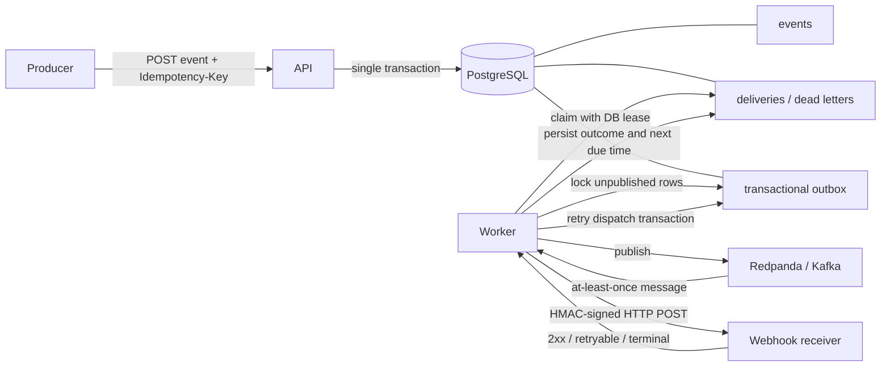

# Webhook Relay

A deliberately small webhook delivery platform built with Kotlin, Java 21,
Spring Boot, PostgreSQL, and Kafka-compatible transport. It demonstrates the
hard parts of reliable webhook delivery: idempotent ingestion, a transactional
outbox, leased worker processing, signed HTTP requests, bounded retries,
dead-letter persistence, and replay.

This is an original reference implementation. It is not presented as
production-proven and contains no benchmark claims.

## One-command local demo

Requirements: Docker with Compose, `curl`, and Python 3.

```bash
./scripts/demo.sh
```

The script builds and starts PostgreSQL, Redpanda, the API, the worker, and a
signature-verifying example receiver. It registers the receiver, submits an
event, waits for delivery, and prints the verified receiver output.

Stop and remove local data with:

```bash
docker compose down --volumes
```

The Compose credentials and all-zero encryption key are intentionally local
development values. Never reuse them outside this demo.

## Architecture



The PostgreSQL commit is the event acceptance boundary. Kafka publishing is
decoupled through the outbox. A published message can be duplicated if the
publisher crashes before marking its row, so the worker claims delivery state
idempotently. HTTP remains at-least-once: a crash after receiver success but
before the database update can send the request again.

## API walkthrough

Swagger UI is at <http://localhost:8080/swagger-ui.html>; generated OpenAPI is
at <http://localhost:8080/openapi>. A reviewed static surface is also
checked in at [`docs/openapi.yaml`](docs/openapi.yaml).

Register an endpoint. Supplying a secret is convenient for a receiver you
control; omit it to generate a 256-bit secret that is returned only in this
response.

```bash
registration="$(
  curl --fail --silent http://localhost:8080/v1/endpoints \
    -H 'Content-Type: application/json' \
    -d '{
      "url": "http://receiver:8080/webhook",
      "description": "example receiver",
      "signingSecret": "local-demo-signing-secret-32-characters-minimum"
    }'
)"
endpoint_id="$(python3 -c 'import json,sys; print(json.load(sys.stdin)["endpoint"]["id"])' <<<"$registration")"
```

Accept an arbitrary JSON event:

```bash
curl --fail --silent \
  -X POST "http://localhost:8080/v1/endpoints/${endpoint_id}/events" \
  -H 'Content-Type: application/json' \
  -H 'Idempotency-Key: invoice-created-001' \
  -H 'X-Correlation-ID: docs-example' \
  -d '{"type":"invoice.created","invoiceId":"inv_123"}' | python3 -m json.tool
```

Repeating the request with the same endpoint-scoped `Idempotency-Key` returns
the original event and delivery (`duplicate: true`) without adding work.

Inspect deliveries:

```bash
curl --silent 'http://localhost:8080/v1/deliveries?limit=20' | python3 -m json.tool
curl --silent "http://localhost:8080/v1/deliveries/${delivery_id}" | python3 -m json.tool
```

Inspect unresolved dead letters and replay one by its dead-letter ID:

```bash
dead_letters="$(curl --fail --silent 'http://localhost:8080/v1/dead-letters?limit=20')"
echo "$dead_letters" | python3 -m json.tool
dead_letter_id="$(python3 -c 'import json,sys; print(json.load(sys.stdin)[0]["id"])' <<<"$dead_letters")"
curl --fail --silent -X POST \
  "http://localhost:8080/v1/dead-letters/${dead_letter_id}/replay" | python3 -m json.tool
```

`POST /v1/deliveries/{deliveryId}/replay` is also available as a convenience
for a delivery already known to be dead-lettered.

## Receiver contract

Each delivery is an HTTP `POST` with the stored JSON payload and:

- `X-Webhook-Id`: stable delivery UUID; receivers should deduplicate on it.
- `X-Webhook-Event-Id`: stable event UUID.
- `X-Webhook-Attempt`: one-based attempt number in the current delivery cycle.
- `X-Webhook-Timestamp`: Unix seconds used by the signature.
- `X-Webhook-Signature`: `v1=<hex HMAC-SHA256>`.
- `X-Correlation-ID`: propagated request correlation ID.

The signed bytes are:

```text
<timestamp>.<exact HTTP request body>
```

Verify with constant-time comparison and reject stale timestamps. The example
receiver in [`examples/receiver/server.py`](examples/receiver/server.py) does
both.

## Delivery behavior

- `2xx`: delivered.
- `408`, `425`, `429`, `5xx`, timeout, or I/O failure: retry with capped
  exponential full jitter.
- Other non-`2xx`, including redirects: dead-letter immediately.
- Retryable failures dead-letter after `RELAY_MAX_ATTEMPTS` (default `8`).
- Replay keeps the delivery ID and original payload, resets its attempt budget,
  records replay metadata, and creates a new outbox dispatch.
- A processing token prevents a stale worker from overwriting a newer result.
  An expired lease permits recovery after a worker crash.

Design rationale is captured in:

- [`ADR 0001: at-least-once delivery`](docs/adr/0001-at-least-once-delivery.md)
- [`ADR 0002: transactional outbox`](docs/adr/0002-transactional-outbox.md)
- [`ADR 0003: retries and dead letters`](docs/adr/0003-retries-and-dead-letters.md)

## Observability

Both applications emit structured Logstash JSON and include correlation and
delivery IDs in MDC where available.

- API health: <http://localhost:8080/actuator/health>
- API Prometheus: <http://localhost:8080/actuator/prometheus>
- Worker health: <http://localhost:8081/actuator/health>
- Worker Prometheus: <http://localhost:8081/actuator/prometheus>

Custom metrics include accepted/duplicate events, outbox publish outcomes,
replays, delivery outcomes, and delivery HTTP duration.

## Configuration

Required in non-demo environments:

| Variable | Purpose |
| --- | --- |
| `DATABASE_URL`, `DATABASE_USERNAME`, `DATABASE_PASSWORD` | PostgreSQL connection |
| `RELAY_MASTER_KEY_BASE64` | Base64-encoded 32-byte AES-256 key for endpoint secrets |
| `KAFKA_BOOTSTRAP_SERVERS` | Worker Kafka-compatible brokers |

Important optional settings:

| Variable | Default |
| --- | --- |
| `RELAY_MAX_ATTEMPTS` | `8` |
| `RELAY_BASE_DELAY` / `RELAY_MAX_DELAY` | `1s` / `5m` |
| `RELAY_LEASE_DURATION` | `2m` |
| `RELAY_CONNECT_TIMEOUT` / `RELAY_REQUEST_TIMEOUT` | `3s` / `10s` |
| `RELAY_SECURITY_ALLOW_HTTP` | `false` |
| `RELAY_SECURITY_ALLOW_PRIVATE_NETWORKS` | `false` |
| `RELAY_MAX_PAYLOAD_BYTES` | `1048576` |
| `RELAY_KAFKA_TOPIC` | `webhook-deliveries` |

HTTP and private/reserved targets are denied by default to reduce SSRF risk.
Both checks are enabled only for the isolated local Compose network.

## Development

The project uses Spring Boot 4.1.0, Kotlin 2.4.10, Gradle 9.6.1, and Java 21
bytecode/toolchains.

```bash
export JAVA_HOME=/opt/homebrew/opt/openjdk@21/libexec/openjdk.jdk/Contents/Home
./gradlew check
./gradlew ktlintFormat
./gradlew dependencyUpdates
```

When Docker is provided by Colima, expose its socket before running the
Testcontainers suite:

```bash
export DOCKER_HOST="unix://${HOME}/.colima/default/docker.sock"
export TESTCONTAINERS_DOCKER_SOCKET_OVERRIDE=/var/run/docker.sock
./gradlew check
```

Tests include deterministic HMAC, encryption, URL policy and jitter tests;
WireMock receiver/signature/transient-failure tests; and PostgreSQL
Testcontainers coverage for duplicate ingestion, outbox rollback atomicity,
dead-letter persistence, and replay. Testcontainers tests skip when Docker is
not available.

Modules:

- `relay-core`: state model, JDBC persistence, migrations, cryptography, retry
  policy, and transactional services.
- `relay-api`: REST/OpenAPI ingestion and inspection application.
- `relay-worker`: outbox publisher, Kafka listener, HTTP delivery, retry
  dispatcher, and metrics.

CI runs formatting/static checks, tests, Compose validation, container builds,
and gitleaks. Dependabot tracks Gradle, Docker, and Actions updates.

## Security and current limitations

- There is no API authentication, authorization, tenant isolation, quota, or
  rate limiting. Put the API behind an authenticated gateway before shared use.
- Endpoint secrets are AES-GCM encrypted, but key rotation and external KMS
  integration are not implemented.
- URL validation resolves and blocks private/reserved addresses, but this small
  implementation does not pin DNS results to the HTTP connection; hardened
  deployments should add DNS-rebinding-resistant egress controls.
- Payload retention, dead-letter/outbox cleanup, partitioning, and archival are
  not automated.
- The simple list endpoint is limit-based, not cursor-paginated.
- `Retry-After` is not honored.
- Kafka and PostgreSQL TLS/authentication are deployment concerns and are
  intentionally absent from local Compose.
- A single PostgreSQL region and a single Redpanda node are used locally; this
  is not a high-availability topology.
- The project has not been load tested and makes no throughput or latency
  claims.

## License

[MIT](LICENSE)
